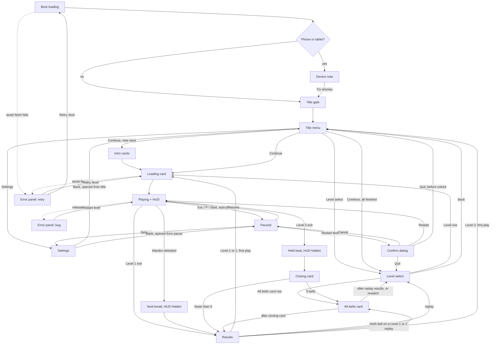

# EXPERIENCE.md — Emberbound

## Foundation

- **Form factor.** Desktop browser, landscape, resizable and fullscreen; keyboard and standard gamepads; current Chrome, Edge and Firefox, Safari best-effort (gdd.md:788-797).
- **UI system (inherited).** DOM overlay above the canvas, one plain-TypeScript module per screen plus CSS, no framework (game-architecture.md:567-572). Delta: this spec adds modules the architecture does not list (Component Patterns › Owning modules; Notes for architecture).
- **Spines.** `DESIGN.md` owns how it looks; this file owns how it behaves. Component names are identical in both files. Token references in braces resolve to DESIGN.md frontmatter.
- **Terms.** "Loading card" is the architecture's "level-line card", shown in its "Level loading" state (game-architecture.md:367, 513).
- **Decision IDs.** D-, F-, A-, Q- and M-numbers refer to `.decision-log.md` in this folder; "draft review" marks decisions confirmed there on 2026-11-13.
- **Visual references.** Greyscale layout mocks with provisional tokens, each with a `.png` beside it: [mockups/key-hud.html](mockups/key-hud.html) (in-play HUD: Emberwood, warden arena, waiting-glow strip), [mockups/key-results.html](mockups/key-results.html) (first play; replay with "New best"), [mockups/key-level-select.html](mockups/key-level-select.html) (8 of 9 bells; all-bells row). The spines win on conflict with any mock; known differences: the "New best" tag position and the warden-bar notch (DESIGN.md Components). Spine-only by decision (F11): title gate and title menu, intro / closing / all-bells cards, loading card, pause, confirm dialog, settings, device note, error panels, boot loading. `imports/` is empty.

## Information Architecture

| Surface | Reached from | Holds | Leaves to |
| --- | --- | --- | --- |
| Boot loading | Page open | Wordmark, `boot-loading-bar` | Title gate, or device note |
| Device note | Boot, phone or tablet detected | `device-note` | Title gate ("Try anyway") |
| Title gate | Boot done | Wordmark, `title-gate-prompt` | Title menu |
| Title menu | Gate; Back from level select or settings; quit before unlock; Level 3 results on a first play | Continue · Level select (once Level 1 is finished) · Settings; `notice-line`s | Intro, loading card, level select, settings |
| Intro cards | First Continue on a new save | 5 × `card-text` | Loading card (Emberwood) |
| Loading card | Continue, intro cards, a level-select row, results on a first play, Retry after a failed level load | `loading-card` | Playing |
| Playing | Loading card, Resume, Restart | World and HUD | Paused, story moment, results, closing card |
| In-level story moment | Warden defeated (seal break); Level 3 exit (held beat) | World only, HUD hidden | Results (Level 2), closing card (Level 3) |
| Paused | Esc / P / Start; auto-pause (D14) | Resume · Restart level · Settings · Quit to level select (Quit to title before unlock) | Playing, settings, confirm dialog |
| Settings | Title menu or pause | Music volume · Effects volume · Reduced motion · Fullscreen · Back | Back to whichever opened it |
| Confirm dialog | Restart level, Quit | Prompt, action, Cancel | Playing (restarted), level select or title, pause |
| Results | End of every level | 4 × `results-stat`, Continue | Next loading card (first play), level select (replay), all-bells card, title |
| Closing card | After the held beat | `card-text` | All-bells card (9 bells) or results |
| All-bells card | After the closing card; after Level 1 or 2 replay results with the ninth bell; level-select row | `card-text` | Results, or level select |
| Level select | Title (Level select; Continue when everything is finished); replay results | `level-select-row` per finished level plus the next unlocked one; "All-bells card" row once 9 bells are found | Loading card, all-bells card, title |
| Error panel (bug) | Release-build invariant failure | `error-panel` bug variant | Playing, level restarted |
| Error panel (retry) | Asset fetch failed after one silent retry | `error-panel` retry variant | The same load again |

Mocks: Playing → [key-hud](mockups/key-hud.html); Results → [key-results](mockups/key-results.html); Level select → [key-level-select](mockups/key-level-select.html). Notices are states of the title menu and settings, not surfaces. Nothing is more than two steps from play: Pause → Settings, or Pause → Confirm.

Source: game-architecture.md:367-371 plus the UX additions (boot, gate, device note, confirm, errors). `errRetry` retries whichever load failed, boot or level, as often as the player presses Retry. After Level 3's results on a first play the game returns to the title menu, where Continue now opens the level select. Restart (from the confirm dialog or the bug panel) fades straight to the level start with run stats reset; no loading card, since the level is already loaded.

## Voice and Tone

Plain and functional (F4). Story voice lives only in card text and loading-card lines, written in the narrative design document and served from the story-text module; it is not repeated here. Rules: sentence case, short, no exclamation marks, no blame (respawns are a number, gdd.md:209), no technical text (game-architecture.md:706), no words on control signs (gdd.md:261). Names on screen use the approved vocabulary (gdd.md:675-682).

| Where | String | Source |
| --- | --- | --- |
| Title gate | "Click or press any key" | D8 |
| Title menu | "Continue" · "Level select" · "Settings" | gdd.md:620 |
| Pause | "Resume" · "Restart level" · "Settings" · "Quit to level select" / "Quit to title" | D9 |
| Settings | "Music volume" · "Effects volume" · "Reduced motion" · "Fullscreen" · "Back"; toggle states "On" / "Off" | D10; draft review |
| Confirm, restart | "Restart level? You'll go back to the start." · "Restart" · "Cancel" | Draft review |
| Confirm, quit | "Quit this level? You'll start it from the beginning next time." · "Quit" · "Cancel" | Draft review |
| Results | "Clear time" 7:48.3 · "Bells" 1 of 3 · "Respawns" 2 · "Embers" 96 of 132; tag "New best"; action "Continue" | D11, gdd.md:630-634; draft review |
| Level select | Names from `content/levels.ts`: "Emberwood", "The Drowned Mill", "Harrowmere ruins"; best time m:ss.s, "–" when none; "All-bells card"; "Back" | Log; draft review |
| HUD | "Bell 2 of 3" · "The Warden" | F2; log; DN-1 (sprint change proposal: the narrative keeps "seal" off screen in version one) |
| Notices | "Progress won't be saved this session." · "Click or press a key for sound" · "Fullscreen isn't available here." · "Gamepad unavailable. Keyboard still works." | D15, A1, D10, Q7 |
| Device note | "Best played on desktop with keyboard or gamepad." · "Try anyway" | gdd.md:797, D16 |
| Errors | "Something went wrong" · "Restart level"; "Couldn't load the level." · "Retry" | game-architecture.md:700-702; draft review |
| Boot | No text besides the wordmark; no tips | D8 |

## Component Patterns

Behaviour only; visual specs are in DESIGN.md.Components.

**Owning modules** (M8; paths under `ui/`, checked against game-architecture.md:1060-1064; "new" = not in the architecture yet, see Notes for architecture):

| Module | Owns |
| --- | --- |
| `overlay.ts` | `hud-mute-indicator` (M6) |
| `screens/hud.ts` | `hud-hearts`, `hud-ember-meter`, `hud-weapon-timer`, `hud-bell-toast`, `hud-warden-bar` |
| `screens/title.ts` | `title-gate-prompt` (the gate is a new screen in it); title menu |
| `screens/results.ts` | `results-stat` |
| `screens/levelSelect.ts` | `level-select-row` |
| `screens/settings.ts` | The settings rows, built from `slider` and `toggle` |
| `screens/pause.ts` | The pause menu, built from shared components |
| `screens/cardText.ts` | `card-text` |
| `screens/deviceNote.ts` | `device-note` |
| `screens/levelError.ts` | `error-panel`, both variants (the retry variant also covers boot loads) |
| Shared module (new) | `menu-item`, `panel`, `scrim`, `slider`, `toggle`, `notice-line`, `confirm-dialog` |
| Boot loading (new) | `boot-loading-bar` |
| Loading card (new) | `loading-card` |
| — (icon set) | `control-glyphs`: `public/assets/icons/`, used by `render/level/controlSigns.ts` and `screens/cardText.ts` |

| Component | Behaviour |
| --- | --- |
| `hud-hearts` | Always three slots during play. `rowanHurt` or `rowanFellInPit`: the rightmost filled heart empties with a short crack and icon shake. `heartRestored`: the heart refills with a short pop after the ember transfer. At one heart left the last heart pulses slowly (≤ 2 Hz, D6) until healed or respawned. `rowanRespawned`: all three refill. |
| `hud-ember-meter` | Shows the sim's count, 0 to 50, by length. Starts empty each level; kept through checkpoints, pit falls and respawns (gdd.md:581). Full with full hearts: holds a steady glow ("waiting"). Restore: empties into the heart in ≤ 0.3 s, then the heart pops. Embers past a full meter change nothing on the HUD. |
| `hud-weapon-timer` | Appears on `weaponCollected` with that weapon's icon; the bar reads the sim's remaining time (20 s) and never runs its own clock. A new pickup swaps the icon and refills. `weaponRunningOut` (3 s left): bar blinks at ≤ 3 Hz in step with the warning sound. Hides on `weaponExpired` and on death; stays through a pit fall (gdd.md:328). |
| `hud-bell-toast` | On `bellFound`: "Bell n of 3" with the bell icon fades in, holds about 2 s, then fades out (UI timings). n counts bells found in this run, matching the results screen; a second bell during the hold replaces the text and restarts the hold. |
| `hud-mute-indicator` | Shown while `isMuted` on every surface after the gate, the loading card included, except cards and in-level story moments (a pause opened during a story moment shows it, like any menu). Owned by the overlay root, not `hud.ts`, and drawn above the scrim (M6). M toggles mute anywhere; there is no gamepad binding (gdd.md:247). Mute is not saved, so each session starts unmuted (game-architecture.md:464). |
| `hud-warden-bar` | Fades in full on `arenaEntered`. Drops on `wardenHit`; the notch marks 15 of 30 HP, where phase 2 starts. On `wardenDefeated` drains to empty and fades with the HUD. Stays through Rowan's death sequence. Hides on `rowanRespawned` at the door and reappears full on the next `arenaEntered`, since the warden resets (gdd.md:405). |
| `menu-item` | Focus moves per Interaction Primitives, with hold-to-repeat; vertical lists wrap; one item is always focused. Closing a sub-surface (settings, confirm dialog) returns focus to the item that opened it. Focus change plays the menu-move sound; activation plays confirm. Nothing locked or disabled is ever listed. |
| `panel` | Holds every menu, results and level select. Fades in and out; never slides. |
| `scrim` | Dims the world under pause, settings from pause, confirm, results and error panels; after Level 3 it dims the last card scene under results. The HUD stays under it; the mute indicator stays above it. Fades with its panel. |
| `slider` | Music and effects volume. Left and right change the value, with hold-to-repeat; mouse click or drag sets it. Applies at once and saves at once (game-architecture.md:467). 11 steps, 0 to 10, shown as a number. |
| `toggle` | Reduced motion and fullscreen. Confirm or click flips it; state text always matches. Reduced motion applies from the next frame and saves. Fullscreen is not saved (not in the save schema, and the browser needs a fresh press); the toggle mirrors the real state, so leaving fullscreen by Esc shows Off. Refused: snaps back and shows the fullscreen `notice-line` until Settings closes (D10). |
| `confirm-dialog` | Opens from Restart level or Quit; one step. Cancel is focused; Back equals Cancel; the action is the other item. |
| `results-stat` | Rows in order: clear time, bells, respawns, embers. Values appear in a stagger of ≤ 0.6 s; a confirm during the stagger completes it, a confirm after it (on Continue) leaves. "New best" sits after the "Clear time" label on a replay whose clear time beats the stored best; never on a first play. Values keep one right edge. Respawns never get a comment or a colour. |
| `level-select-row` | One per finished level plus the next unlocked one. Bell slots show the union across all runs (game-architecture.md:468). Confirm starts that level as a replay. Default focus: the level just played when arriving from results, otherwise the next unlocked level, or the first row when everything is finished. Rewatch variant: plays the all-bells card, then returns here. Back → title. |
| `card-text` | One line per card. All input, Back included, is ignored before the ~1.5 s minimum (gdd.md:659), and a press counts only if it began after the card appeared. Then confirm advances one card; Back skips the rest of the sequence where allowed: intro always, closing and all-bells on replays (D12). Once the minimum passes, the confirm glyph for the last-used device fades in (placement in DESIGN.md `card-text`). |
| `loading-card` | Every load shows the level name and its line (F10). Held at least ~3 s † of reading time (gdd.md:647) and until loading finishes, then advances by itself. On a replay, once loading is done, the advance hint fades in and confirm skips the rest of the reading floor. Pause input is ignored (State Patterns); M works. |
| `title-gate-prompt` | Any key, click or gamepad button passes. A key or click resumes the `AudioContext`, gives the frame keyboard focus and sets the last device (D8, game-architecture.md:577). A gamepad button sets the device but cannot unlock audio (A1). |
| `boot-loading-bar` | Fills with shared-asset load progress (game-architecture.md:513); target first input ≤ 10 s. No input. Done: fades to the gate or the device note. |
| `notice-line` | Static, no dismiss. Storage notice: title menu, whole session. Audio notice: title menu until audio unlocks. Fullscreen notice: settings, until it closes. Gamepad notice: pause and title menus, from the moment the pad is disabled until the session ends (Q7). |
| `error-panel` | Bug: shown by the frame loop in release builds; "Restart level" is focused and restarts the level. Retry: shown after one silent retry fails; "Retry" is focused and repeats the load. No technical text in either. |
| `device-note` | Shown instead of the gate on phones and tablets: a coarse primary pointer and no fine pointer anywhere, checked with `matchMedia` in `platform/device.ts` (Q3). "Try anyway" (click, tap, Enter or gamepad south) continues to the gate, for tablets with a keyboard (D16). |
| `control-glyphs` | Keyboard set or gamepad set per last device. In-world signs (`render/`) swap on the next frame after a device change. Keyboard signs show the arcade set: arrows to move, ↑ aim up, ↓ crouch, Z jump, ↓ + Z drop-through, X spit (F6). Gamepad signs use position glyphs only (F3); the spit sign lights the west face button. |

## State Patterns

| Surface | State | Treatment |
| --- | --- | --- |
| Boot loading | Cold load | Bar fills; no input expected. |
| Boot, loading card | Asset fetch fails | One silent retry, then `error-panel` retry (game-architecture.md:702). |
| Device note | Phone or tablet | Shown instead of the gate; "Try anyway" continues to the gate. |
| Title gate | Frame not focused (A3) | The prompt invites the click that gives focus. |
| Title menu | Audio locked after a gamepad gate (A1) | Game proceeds silently; audio `notice-line` until a key or click. |
| Title menu | First run, no level finished | Continue and Settings only; Continue plays the intro, then Emberwood. |
| Title menu | Level 1 finished / everything finished | Level select appears / Continue opens the level select (gdd.md:621-622). |
| Title menu | Storage refused | Storage `notice-line`; progress lives in memory for the session (D15). |
| Title menu | Corrupt or old save | Fresh save, no notice (game-architecture.md:702; Q7). |
| Every menu | Focus | Default on the primary action; closing a sub-surface returns focus to the item that opened it; mouse hover moves focus; cursor visible. |
| Cards | Input; first play vs replay | All input, Back included, ignored before the ~1.5 s minimum; a press counts only if it began after the card appeared. Intro skippable always; closing and all-bells only on replays. |
| Loading card, cards | Esc / P / Start, auto-pause trigger | Ignored: nothing runs. An auto-pause trigger only clears held inputs (M5). |
| All-bells card | Rewatch from the level select | Skippable with Back; returns to the level select. |
| Loading card | First play vs replay | Name and line on every load (F10). First play: the ~3 s floor holds. Replay: confirm skips the floor once loading is done. |
| Playing | Normal | HUD per the hierarchy below; cursor hidden. |
| Playing | Low health | Last heart pulses ≤ 2 Hz. No vignette or edge tint (D6). |
| Playing | Weapon running out | Bar blinks ≤ 3 Hz with the warning sound. |
| Playing | Full meter, full hearts | Steady glow; next heart lost is refilled at once with the transfer. |
| Playing | Pit fall | Canvas fades 0.5 s under the HUD; one heart empties; the weapon stays. |
| Playing | Death and respawn | HUD stays through the 0.85 s sequence; weapon timer removed; respawn refills three hearts; meter kept. |
| Playing | In-level story moment | HUD fades out on `storyStarted` and stays hidden until the level ends. Play input ignored, except jump or confirm skipping on replays (game-architecture.md:446). |
| Playing | Pause or auto-pause during a story moment, the death sequence or the pit fade | Allowed: the sim stops and resumes where it was (M5). |
| Playing | Tab hidden, window blur, fullscreen exited, gamepad disconnected | Auto-pause (D14). Held inputs cleared so Rowan stops. Pause menu with Resume focused; never auto-resumes. |
| Playing | Gamepad error | Gamepad off for the session, keyboard keeps working (game-architecture.md:560). Treated like a disconnect: auto-pause, and the pause menu shows the gamepad `notice-line` (Q7). |
| Playing | Release bug | `error-panel` bug over a scrim; the loop keeps running. |
| Paused | First Level 1 play | Last item reads "Quit to title". |
| Settings | Opened from title vs pause | Back returns to the opener; from pause the world stays dimmed under the scrim. |
| Settings | Fullscreen refused | Toggle snaps back; fullscreen `notice-line`. |
| Confirm dialog | Open | Cancel focused; Back cancels. |
| Results | Stagger / first play / beaten best | Confirm completes the stagger / no tag / "New best". |
| Results | Level 3 | Comes after the closing card and the all-bells card if earned (gdd.md:629); the scrim dims the last card scene, not the world. |
| Level select | Unlocked level never finished | Time "–", three outlined bells. |
| Level select | All 9 bells found | "All-bells card" row after the level rows, before Back. |

## Interaction Primitives

| Action | Keyboard | Gamepad | Mouse |
| --- | --- | --- | --- |
| Move focus | Arrows or WASD | D-pad or left stick (play thresholds) | Hover |
| Confirm | Enter or Space | South | Click |
| Back | Esc or Backspace | East | Back row |
| Change slider value | Left / right, A / D | D-pad or stick left / right | Click or drag the track |
| Pause and resume in play | Esc or P | Start | — |
| Mute | M | None | — |

- **Back** goes up one level. On the pause menu it resumes; on the title menu it does nothing. On screens opened from pause, Esc is Back, not pause.
- **Hold-to-repeat.** A held direction on a list or slider repeats after 0.4 s, at 8 steps per second.
- **Skips.** Cards: confirm advances one after the minimum, Back skips the rest where allowed. Loading card: confirm skips the reading floor on replays, once loading is done (F10). In-level moments: jump or confirm, replays only.
- **Guards.** The ~1.5 s card minimum (Back included, presses must begin on the card), the two-press results screen and the Cancel-first confirm all stop a double press from losing anything.
- **Transitions.** Fades only, no slides (D13), timed by the table below. The cursor hides when play starts and shows when any menu opens.
- **Sounds.** Menu move, confirm, back and pause (gdd.md:763), through `playUiSound`.

**UI timings** (M2). Provisional; all in one module, `core/uiTimings.ts`, so `input/`, `app/` and `ui/` read the same values (DN-2, settled in the architecture); each value is tuned in the epic that builds its surface. Seconds, never frames.

| Name | Value | Used by |
| --- | --- | --- |
| `panelFadeSeconds` | 0.15 | Menu and panel fade in and out |
| `scrimFadeSeconds` | 0.2 | Scrim fade |
| `hudStoryFadeSeconds` | 0.4 | HUD fade-out on `storyStarted` |
| `bellToastInSeconds` / `bellToastHoldSeconds` / `bellToastOutSeconds` | 0.15 / 2.0 / 0.4 | `hud-bell-toast` |
| `emberTransferSeconds` | 0.3 | Ember-to-heart transfer |
| `resultsStaggerSeconds` | 0.6 | Whole results stagger |
| `wardenBarFadeInSeconds` | 0.4 | `hud-warden-bar` on `arenaEntered` |
| `bootFadeSeconds` | 0.3 | Boot loading fade-out |
| `cardTextFadeSeconds` | 0.3 | Card text fade |
| `advanceHintFadeSeconds` | 0.3 | Advance hint on cards and the replay loading card |
| `loadingCardFadeSeconds` | 0.3 | Loading card in and out |
| `restartFadeSeconds` | 0.3 | Restart: fade out, level start, fade in |
| `heartCrackSeconds` / `heartPopSeconds` | 0.15 / 0.15 | `hud-hearts` lose and restore |
| `wardenBarDrainSeconds` | 0.4 | `hud-warden-bar` on `wardenDefeated` |
| `menuRepeatDelaySeconds` / `menuRepeatIntervalSeconds` | 0.4 / 0.125 (8 per second) | Hold-to-repeat |

Referenced, not defined here: the card minimum (~1.5 s †, gdd.md:659) and the loading-card reading floor (~3 s †, gdd.md:647) are GDD values; their code values live in `core/uiTimings.ts` too (DN-2).

## HUD & Diegetic UI

Non-diegetic overlay: hearts, ember meter, weapon timer, bell toast and warden bar (`hud.ts`), plus the mute indicator (overlay root, M6). Layout: [mockups/key-hud.html](mockups/key-hud.html). Diegetic: the control signs on carved waymarkers, drawn by `render/` in Level 1 only, wordless and clear of the play area (gdd.md:261-265); embers tracing jump arcs; the warden's in-world telegraphs. Nothing else.

| Element | Priority | Visible |
| --- | --- | --- |
| `hud-hearts` | Critical | All of play, including the death sequence and pit fade |
| `hud-ember-meter` | Critical | All of play |
| `hud-warden-bar` | Critical in the arena | `arenaEntered` to `wardenDefeated` |
| `hud-weapon-timer` | Secondary | Only while a weapon is active |
| `hud-bell-toast` | Transient | About 2 s per bell |
| `hud-mute-indicator` | Status | While muted, on every surface after the gate except cards and in-level story moments; above the scrim |

- The `hud.ts` elements are hidden during in-level story moments, cards and loading, and sit under the scrim while paused (log).
- Absent by design: clock, score, persistent bell counter, minimap, damage vignette (D4, D6; PROJECT_BRIEF.md:63, 67).
- The HUD keeps to the top band. The warden bar is top-centre so the arena floor, where millstone shadows warn, stays clear (gdd.md:413).

## Input Schemes

- **Keyboard.** Play bindings as in gdd.md:237-248, with alternate key sets as the only flexibility; no remapping in v1 (D19). Control signs teach the arcade set only: arrows, Z, X (F6); the other sets work but are never shown. Menu keys as above.
- **Gamepad.** Standard mapping, Xbox and PlayStation layouts as the browser reports them (gdd.md:792). Every menu works on the pad. If the browser refuses or a read throws, the pad is off for the session and the keyboard keeps working.
- **Mouse.** Menus only, never required. Hover focuses, click confirms.
- **Last device.** A key press or click sets keyboard; a gamepad button, or a stick past the play thresholds, sets gamepad (game-architecture.md:561). It picks the control-sign glyphs and the card advance hint; menu layout never changes.
- **Glyphs (F3).** One neutral gamepad set: a diamond of four face buttons with the one to press lit; sticks and d-pad drawn as directions. No platform detection, letters, colours or trademarks.
- **Touch.** None in v1; phones and tablets get the device note.

## Game Feel & Juice

World hit feedback (hit-stop, shake, blink, burst, flash) follows the GDD table (gdd.md:370-378). UI-side feedback (durations in UI timings):

| Event | UI response | With reduced motion (D17) |
| --- | --- | --- |
| Focus move, confirm, back, pause | Matching interface sound; focus ring jumps, no tween | Same |
| `rowanHurt`, `rowanFellInPit` | Heart empties with a crack and icon shake | Crack, no shake |
| `heartRestored` | Ember drains into the heart (≤ 0.3 s), heart pops | Same |
| One heart left | Slow pulse, ≤ 2 Hz | No pulse; the single heart is the signal |
| Meter full, hearts full | Steady glow | Same |
| `weaponRunningOut` | Bar blink ≤ 3 Hz with the warning sound | Same (small area, paired with sound) |
| `bellFound` | Toast plus the bell sound, which opens Elin's motif (gdd.md:746) | Same |
| `wardenDefeated` | Bar drains and fades; HUD fades out | Same |
| Results | Values stagger in over ≤ 0.6 s | Same |

Reduced motion also turns screen shake off and turns full-screen flashes, such as the seal-break ember flash, into a short fade. Hit-stop and the 9 Hz invulnerability blink stay: they carry timing and readability, and the blink covers only Rowan (D17).

## Accessibility Floor

- **Contrast.** Targets and HUD backing live in DESIGN.md.Colors.
- **Not colour alone (D18).** Hearts are counted shapes, meters read by length, the weapon timer carries an icon, bell slots are filled or outlined, toggles show On / Off.
- **Audio has a visual twin (D18).** Weapon warning ↔ bar blink; warden warnings ↔ in-world telegraphs (gdd.md:412-423). No dialogue, so no captions are needed.
- **Flashes.** No large-area flash faster than 3 per second (D18).
- **Motion.** One reduced-motion setting with the scope above (D17). A new save takes its default from the browser's `prefers-reduced-motion` (Q5).
- **Input.** Completable keyboard-only or gamepad-only, every menu included; mouse optional (D19). Gamepad-only players play silently until one key press or click unlocks audio (A1).
- **Time.** No timed UI decisions. Cards and results wait for the player; the loading card auto-advances, and on replays confirm can skip its reading floor. Pause is always one press away, and focus loss pauses.
- **Text.** Every text token has a pixel floor (DESIGN.md.Typography). English only.
- **Screen readers.** Not targeted in v1. Menus are native buttons, so their labels are exposed; nothing further (Q6).

## Responsive & Platform

- **Resize.** `overlay.ts` recomputes `--tile` from the logical view in `sim/config.ts` (formula `{spacing.tile}`, M3); HUD anchors follow the viewport corners inside `{spacing.safe-margin}`.
- **Aspect.** Wide windows put the HUD over extra backdrop; narrower ones (4:3) show extra rows above and below. The play box is never smaller than 19 × 10.4 tiles (gdd.md:796).
- **Refresh rate.** UI animation is timed in seconds, never frames, so 60, 120 and 144 Hz look the same (gdd.md:779).
- **Cost.** Animate only opacity and transform; the overlay touches the DOM only on change, so it stays inside the 16.7 ms frame.
- **itch.io embed.** 1280 × 720 with itch.io's own fullscreen button on (Q9); `--tile` is about 67 px there, so every text floor holds. Verify at the Epic 6 private upload.
- **Phones and tablets.** Device note (D16).

## Browser Constraints

Every optional feature (gamepad, storage, audio, fullscreen) is wrapped at its edge; its first failure turns it off for the session, logs once, and the game keeps running (game-architecture.md:701; gdd.md:784).

| Constraint | Behaviour | Verify |
| --- | --- | --- |
| Autoplay and user activation | `AudioContext` resumes on the gate's key or click (game-architecture.md:577). Gamepad presses are not user activation (A1): silent play plus the audio notice until a key or click. | Epic 6 private itch.io upload |
| Fullscreen | Needs user activation and the iframe's fullscreen permission (game-architecture.md:174). A gamepad toggle may be refused: snap-back plus notice (A1, D10). The Esc that leaves browser fullscreen may not reach the page (A2): P / Start still pause, and leaving fullscreen during play auto-pauses (D14). | Epic 6 upload |
| iframe focus | Keys reach the game only once the frame has focus (A3); the gate's "Click or press any key" covers first focus. Clicking outside the frame blurs it and auto-pauses; a click back focuses it. | Epic 6 upload |
| Storage partitioning | itch.io iframe storage may be partitioned or blocked (game-architecture.md:471): in-memory save plus the storage notice (D15). | Epic 6 upload |
| Gamepad permission | May be refused inside the iframe: pad off, keyboard works (game-architecture.md:560). | Epic 6 upload |
| Page scrolling | Bound keys call `preventDefault` while the game has focus, so Space and arrows never scroll the host page. | Epic 6 upload |

## Inspiration & Anti-patterns

- **Lifted, structure only:** Toki (1989): short stages, a boss per stage, timed weapon pickups, minus its punishment (gdd.md:103).
- **Benchmarks, not sources:** Celeste and Hollow Knight for tight controls and a hand-made look (gdd.md:69). Copy nothing (CLAUDE.md hard limits).
- **Rejected:** lives, countdown and game over (gdd.md:895); a score (gdd.md:587); the Sprout prototype's long hint box that covered the play area (PROJECT_BRIEF.md:218); text teaching what layout should teach (gdd.md:133); damage vignettes (D6); platform-branded glyphs (F3).

## Key Flows

### Marta finishes Emberwood on her first evening

Marta, 46, grew up on arcade platformers; first evening, a 2020 laptop, keyboard, the itch.io page in Firefox.

1. The page opens on the boot screen: wordmark and `boot-loading-bar`, no tips.
2. The gate reads "Click or press any key". She clicks in the frame: sound starts, the frame takes keyboard focus, last device is keyboard. The title menu shows Continue (focused) and Settings.
3. Continue plays the five intro cards. She presses Enter on each once the advance hint appears.
4. The loading card shows "Emberwood" and its line for about 3 s, then the level fades in.
5. A waymarker shows the arrow keycaps for moving. Top-left: three hearts and an empty ember meter, nothing else ([key-hud](mockups/key-hud.html), frame A).
6. Two hits leave one heart, which starts its slow pulse. Fifty embers later the meter drains into the empty heart, it pops, and the pulse stops.
7. She dies twice before a checkpoint. The HUD stays through each death; she respawns with three hearts and the meter as it was.
8. **Climax:** She walks under the garland arch at the wedding glade. Results stagger in: "Clear time" 7:48.3, "Bells" 1 of 3, "Respawns" 2, "Embers" 96 of 132. Respawns sits in the same plain style as every other row; nothing scolds her ([key-results](mockups/key-results.html), frame A).
9. Enter on Continue opens the loading card for The Drowned Mill and its line.

Failure: mid-level she alt-tabs to answer a message. The window blur auto-pauses and clears her held arrow key, so Rowan stops. Back in the browser, the pause menu waits with Resume focused; Enter (or a click if the frame lost focus) resumes.

### Tomás beats the Warden of the First Seal on a gamepad

Tomás plays on a desktop PC with a standard gamepad and starts the session from the pad.

1. At the gate he presses the south button. The game goes on, but audio stays locked (A1): the title menu shows "Click or press a key for sound". He taps a key; sound starts and the notice goes.
2. In The Drowned Mill he reaches the checkpoint at the warden's door and takes the triple shot just before it. The weapon timer appears right of the ember meter.
3. He enters the arena and the door shuts. The warden bar fades in top-centre: "The Warden", full, notched at half ([key-hud](mockups/key-hud.html), frame B).
4. At 3 s left the timer bar blinks with the warning sound, then the timer goes.
5. The bar crosses the notch: the warden flinches and the music shifts. The floor stays clear of HUD, so the millstone shadows read.
6. Failure: a wheel roll takes his last heart in phase 2. The HUD and warden bar stay through the death sequence; he respawns at the door with three hearts, the warden bar hidden and the triple shot back in its place. Entering the arena again brings the bar back full.
7. Second attempt: he takes the pickup again and dodges each telegraphed attack.
8. **Climax:** The final hit. The warden bar drains to empty and fades, the rest of the HUD fades with it, and the seal break plays without text: the wheel stops, one horn breaks, and one of Rowan's hands turns human (gdd.md:723-728). On this first play his presses do nothing.
9. Results show "Respawns" 1. South on Continue opens the loading card for Harrowmere ruins.

### Marta finishes Harrowmere ruins

Marta's third evening, same laptop and keyboard; Emberwood and The Drowned Mill are finished, with 3 of 6 bells.

1. She clicks the gate. The title menu shows Continue (focused), Level select and Settings; she moves to Settings and confirms.
2. On "Music volume" she holds the left arrow: after 0.4 s the value steps down at 8 per second, and she lets go at 6. She sets "Reduced motion" to On. Each change applies and saves at once. Back returns to the title menu with focus on Settings.
3. Continue: the loading card shows "Harrowmere ruins" and its line, held at least ~3 s on this first play, then the level fades in.
4. Rowan arrives changed, as the seal break left him: one horn broken, one hand human, and he can grab ledges (first-arrival form, gdd.md:526-530).
5. In the last mixed-enemy stretch a hit empties a heart. With reduced motion the heart cracks without its icon shake, and the screen stays still (D17).
6. A short calm walk ends at the town's fallen fire bell (gdd.md:609). The held beat starts: the HUD fades out, control stops for about 3 s, no text. On this first play her presses do nothing (gdd.md:650).
7. **Climax:** The closing card fades in with its line. An early Enter does nothing before the ~1.5 s minimum; then the confirm glyph fades in at the lower right, and she advances when she is ready.
8. With fewer than 9 bells, no all-bells card follows; she has not earned it (gdd.md:636). The results stagger in over the last card scene, dimmed by the scrim, after the story has landed (gdd.md:629).
9. Continue returns to the title menu. From now on, Continue there opens the level select.

### Ines finds her ninth bell in Emberwood

Ines has finished version one with 8 of 9 bells; Emberwood is missing one.

1. On the title menu she picks Level select. The Emberwood row shows her best time and two filled bells beside one outline ([key-level-select](mockups/key-level-select.html), frame A).
2. She confirms. The loading card shows "Emberwood" and its line; on this replay she presses confirm to skip the reading pause once loading is done.
3. A bad start: she falls into an early pit. She pauses and picks "Restart level"; the dialog asks "Restart level? You'll go back to the start." with Cancel focused. She moves to "Restart" and confirms: the level fades straight to its start with run stats reset, and no loading card.
4. Rowan is the full beast again (replay-form rule, gdd.md:526). She takes the two bells she knows: "Bell 1 of 3", "Bell 2 of 3".
5. She searches the stretch she always rushed and finds the third: "Bell 3 of 3", over the opening notes of Elin's motif. She reaches the garland arch faster than ever.
6. Results stagger in: "New best" sits after the "Clear time" label, and "Bells" reads 3 of 3. One press completes the stagger, the next continues ([key-results](mockups/key-results.html), frame B).
7. **Climax:** Because that was her ninth bell, the all-bells card plays after the results (gdd.md:637). Back would skip it on a replay; she watches it through.
8. The level select returns with focus on Emberwood: three filled bells, the new best time, and a new "All-bells card" row below the level rows, above Back ([key-level-select](mockups/key-level-select.html), frame B).

Failure: she reaches the arch with 2 of 3. Results show "Bells" 2 of 3, no card plays, and the level select returns with focus on Emberwood.

## Open Questions & Notes for GDD

**Folded in on 2026-11-13** through `gds-correct-course` ([sprint-change-proposal-2026-11-13.md](../../sprint-change-proposal-2026-11-13.md)): the GDD, narrative, architecture (v1.1), project context and epics now carry the notes below. They stay here as the record.

**Notes for GDD** (log, consolidated): warden HP bar; bell counter toast; mute indicator; boot loading screen; title "press any key" gate; pause "Quit to title" before unlock, plus restart and quit confirms; mute as M only (settings list reconciled, gdd.md:765 vs 803); wider reduced-motion scope (gdd.md:803); extra auto-pause triggers (gdd.md:802); storage-refused notice. Also not in the GDD: the "New best" tag on results (D11) and the device note's "Try anyway" (D16).

Also new to the GDD from the draft review: the gamepad-unavailable notice (Q7), the reduced-motion default from `prefers-reduced-motion` (Q5), the arcade key set on control signs (F6), and the credits rule (Q10).

Loading card (F10): every load shows the level name and its line; on replays, confirm skips the reading floor once loading is done. This reconciles gdd.md:628 (the line named only on a first play) with gdd.md:647 (one line before each level).

**Notes for architecture** (fold in through `gds-correct-course`):

- Extra auto-pause triggers (window blur, fullscreen exit, gamepad disconnect or disable) handled beside `platform/visibility.ts` (D14, game-architecture.md:371); the `render/fx` flash reads `reducedMotion` (D17, game-architecture.md:135, 412); an audio-locked state after a gamepad-passed gate (A1); the `reducedMotion` default in `app/settings.ts` (Q5).
- `--tile` is set by `ui/overlay.ts` from the logical-view size in `sim/config.ts` (an allowed import, game-architecture.md:1174), not hard-coded in CSS (M3).
- Modules missing from game-architecture.md:1060-1064 (M8): a shared component module (`menu-item`, `panel`, `scrim`, `slider`, `toggle`, `notice-line`, `confirm-dialog`); boot loading; the title gate, inside `title.ts`; the loading card. `overlay.ts` also owns the mute indicator (M6), and `levelError.ts` also serves boot-load failures. The CSS class rule "prefixed by screen" (game-architecture.md:1149) has no prefix yet for shared components.
- UI timings live in one module, `core/uiTimings.ts` (M2, DN-2).

**Notes for epics** (fold in through `gds-correct-course`):

- Epic 3 builds the bare title gate (wordmark → "Click or press any key" → intro cards → Emberwood), so playtests have audio and the intro (F5; epics.md › Epic 3 › In scope). The title menu, level select, saving and settings stay in Epic 6 (epics.md › Epic 6 › In scope).
- Extend Epic 0's scope (F9): `docs/STYLE_GUIDE.md` (epics.md › Epic 0 › style guide) also records values for the 16 overlay colour roles and the 3 typefaces (licence checked, ≤ 0.3 MB) and re-measures the contrast table; DESIGN.md is then updated through `gds-ux` Update. Every later epic reads the tokens, so Epic 1 already gets the Epic 0 values; Epic 3's final HUD (epics.md › Epic 3 › final HUD) judges them in play.

**Browser checks on the Epic 6 private itch.io upload:** A1 gamepad gate and audio unlock, gamepad fullscreen refusal; A2 Esc leaving fullscreen; A3 iframe focus; storage partitioning; gamepad permission in the iframe; page scrolling; the 1280 × 720 embed and itch.io's fullscreen button (Q9).

**Open, decided outside this UX run:**

1. The title backdrop behind the gate and title menu (Epic 0 style, Epic 6 build).
2. Credits: on the itch.io page unless an asset licence requires in-game credit, in which case a "Credits" row joins Settings (Q10). Settled once `docs/ASSETS.md` lists every licence.
3. A consent prompt, if release analytics are chosen (gdd.md:883); it would add a surface.
